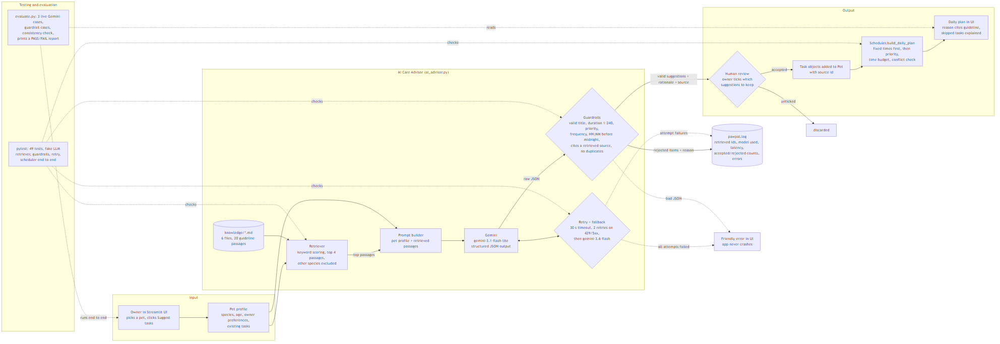

# PawPal+ with AI Care Advisor

PawPal+ is a Streamlit app that plans a pet owner's day of care tasks across all of their pets. This version adds an **AI Care Advisor**: a retrieval-augmented generation (RAG) feature that looks up pet-care guidelines for a specific pet, asks Gemini to turn them into concrete tasks, checks every suggestion with guardrails, and lets the owner accept them into the real schedule. It matters because busy owners often don't know *what* a pet needs (a senior cat, a new puppy), not just *when* to do it, and every AI suggestion here is traceable to a written guideline.

## Original project

This builds on **PawPal+ (Module 2)**, a pet-care planning assistant. The original version let an owner add pets and care tasks (duration, priority, optional fixed time, daily/weekly recurrence) and generated a daily plan that respects the owner's available minutes, places fixed-time tasks first, fills gaps by priority, flags overlapping tasks, and explains why each task was scheduled. All scheduling was rule-based Python with no AI inside the app.

## What the AI adds

- **Retrieve:** for the chosen pet, a keyword retriever scores 20 guideline passages in `knowledge/` (dog, cat, life stages, feeding, medication, grooming/enrichment) using the pet's species, age group and owner preferences, and returns the top 4. Passages for the other species are excluded.
- **Generate:** the pet profile, existing tasks and retrieved passages go into a fixed prompt. Gemini must answer in a JSON schema (title, duration, priority, frequency, optional time, source, rationale) and is told to use only the provided guidelines.
- **Check:** guardrails reject any suggestion with a bad title, a duration outside 1-240 minutes, an invalid priority or frequency, an invalid or past-midnight time, a source that was not retrieved, or a title that duplicates an existing task. Rejections are shown in the UI and logged.
- **Human review:** the owner ticks which suggestions to keep. Accepted ones become normal `Task`s that carry their source id, and the scheduler's explanation cites it, e.g. `fixed at 07:00; high priority; per dog.md#exercise-and-walks`.
- **Reliability:** each Gemini call has a 30 s timeout and 2 retries with backoff on overload (429/5xx), then falls back to a second model. Any failure becomes a short, friendly message in the UI instead of a crash. Activity is logged to `pawpal.log`.

The retrieved passages drive the output: the AI can only cite what was retrieved, and a suggestion citing anything else is thrown out.

## Architecture overview

Source: [`diagrams/system_architecture.mmd`](diagrams/system_architecture.mmd) (Mermaid). Rendered copy: `assets/system_architecture.png`.



Data flows left to right. The owner picks a pet in the Streamlit UI. The **retriever** reads the knowledge base and picks the most relevant passages. The **prompt builder** combines them with the pet profile and sends them to **Gemini**, wrapped in a **retry/fallback** layer. Gemini's JSON goes through the **guardrails**, which pass valid suggestions to **human review** and send rejections to the log. Accepted tasks are added to the pet, and the existing **scheduler** builds the daily plan. Testing sits alongside: **pytest** checks the retriever, guardrails, retry logic and scheduler with a fake LLM, and **`evaluate.py`** runs the whole system against real Gemini and prints a PASS/FAIL report.

## Setup

Requires Python 3.10+ and a free Gemini API key from [Google AI Studio](https://aistudio.google.com/apikey).

```bash
git clone <this repo>
cd applied-ai-system-final
python -m venv .venv
source .venv/bin/activate        # Windows: .venv\Scripts\activate
pip install -r requirements.txt
cp .env.example .env             # Windows: copy .env.example .env
```

Open `.env` and paste your key after `GEMINI_API_KEY=`. `GEMINI_MODEL` and `GEMINI_FALLBACK_MODEL` can be changed if a model is unavailable.

| Command | What it does |
|---|---|
| `streamlit run app.py` | Starts the app |
| `python -m pytest` | Runs the 49 unit tests (no API key or network needed) |
| `python evaluate.py` | Runs the live end-to-end evaluation against Gemini |
| `python evaluate.py --offline` | Runs only the guardrail evaluation (no API key needed) |
| `python main.py` | Command-line demo of the original scheduler |

In the app: set the owner (optionally add care notes such as "senior cat, joint stiffness", which the retriever uses), add a pet (name, species), open **AI Care Advisor**, click **Suggest tasks**, untick anything you don't want, click **Add selected tasks**, then **Generate schedule**.

## Sample command executions

Unit tests (no API key needed):

```
$ python -m pytest
collected 49 items

tests\test_ai_advisor.py ............................                    [ 57%]
tests\test_pawpal.py .....................                               [100%]

============================= 49 passed in 1.30s ==============================
```

Live evaluation against Gemini (excerpt, full output in [`eval_output.txt`](eval_output.txt)):

```
$ python evaluate.py

=== Case 1: Biscuit, 4-year-old dog, preferences={}
  Retrieved: ['dog.md#dental-care', 'dog.md#exercise-and-walks', 'dog.md#feeding-routine', 'life_stages.md#adult-pets']
  Suggested: Morning walk (30 min, high, daily, 07:00) <- dog.md#exercise-and-walks
  ...
    [PASS] advisor returned without error
    [PASS] at least one suggestion accepted
    [PASS] every suggestion cites a retrieved passage
    [PASS] no suggestion duplicates an existing task
  ...
=== Consistency: Case 1 run again
  Source overlap: 100%
    [PASS] repeat run cites mostly the same guidelines (>= 50% overlap)

=== Guardrail cases (scripted LLM output)
  Rejected: 'Morning walk' - duplicates an existing task
  Rejected: 'Agility class' - cites a source that was not retrieved
  Rejected: 'Midnight snack' - invalid time
  Rejected: 'Marathon' - duration_minutes must be an integer from 1 to 240
  Rejected: 'Late walk' - task would end after midnight
  Accepted: ['Evening walk']
  Non-JSON reply -> error: Gemini returned unparseable JSON: Expecting value: line 1 column 1 (char 0)
  Outage -> error: Gemini is overloaded right now (tried primary and fallback models). Please try again in a minute.
  Senior cat retrieval: ['life_stages.md#senior-pets', 'cat.md#litter-box-care', 'cat.md#play-and-enrichment']

=== Summary: 25/25 checks passed
```

## Sample interactions

Real output from `python evaluate.py` (model `gemini-3.1-flash-lite`, 90 minutes available). Full log: [`eval_output.txt`](eval_output.txt).

### 1. Adult dog, no preferences

**Input:** Biscuit, 4-year-old dog.

```
Retrieved: ['dog.md#dental-care', 'dog.md#exercise-and-walks', 'dog.md#feeding-routine', 'life_stages.md#adult-pets']
Suggested: Morning walk (30 min, high, daily, 07:00) <- dog.md#exercise-and-walks
Suggested: Evening walk (30 min, high, daily, 18:00) <- dog.md#exercise-and-walks
Suggested: Morning meal (15 min, high, daily, 07:00) <- dog.md#feeding-routine
Suggested: Evening meal (15 min, high, daily, 18:00) <- dog.md#feeding-routine
Suggested: Teeth brushing (5 min, medium, weekly, flexible) <- dog.md#dental-care
Today's Schedule for Jordan (90 min available):
  07:00 - Morning walk for Biscuit (30 min) [fixed at 07:00; high priority; per dog.md#exercise-and-walks]
  08:00 - Teeth brushing for Biscuit (5 min) [medium priority; 5 min fits in the 30 min left; per dog.md#dental-care]
  18:00 - Evening walk for Biscuit (30 min) [fixed at 18:00; high priority; per dog.md#exercise-and-walks]
  Skipped: Morning meal for Biscuit (15 min) - conflicts with another task
  Skipped: Evening meal for Biscuit (15 min) - conflicts with another task
```

Every task cites a retrieved guideline. Gemini put the meals at the same times as the walks, so the scheduler's conflict check skipped them and said why.

### 2. Senior cat with a preference

**Input:** Luna, 12-year-old cat, owner note "senior cat, joint stiffness".

```
Retrieved: ['cat.md#litter-box-care', 'cat.md#play-and-enrichment', 'life_stages.md#senior-pets']
Suggested: Gentle exercise session (15 min, medium, daily, flexible) <- life_stages.md#senior-pets
Suggested: Daily litter box scoop (5 min, high, daily, flexible) <- cat.md#litter-box-care
Suggested: Full litter change (15 min, medium, weekly, flexible) <- cat.md#litter-box-care
Suggested: Play session with wand toy (10 min, medium, daily, flexible) <- cat.md#play-and-enrichment
Today's Schedule for Jordan (90 min available):
  08:00 - Daily litter box scoop for Luna (5 min) [high priority; ...; per cat.md#litter-box-care]
  08:05 - Play session with wand toy for Luna (10 min) [medium priority; ...; per cat.md#play-and-enrichment]
  08:15 - Gentle exercise session for Luna (15 min) [medium priority; ...; per life_stages.md#senior-pets]
  08:30 - Full litter change for Luna (15 min) [medium priority; ...; per cat.md#litter-box-care]
```

The age and the owner's note pulled in the senior-pets passage, and no dog guidelines were retrieved.

### 3. Puppy that already has a task

**Input:** Pip, 0-year-old dog, existing task "Morning walk", owner note "new puppy, training".

```
Retrieved: ['dog.md#dental-care', 'dog.md#training-and-enrichment', 'grooming_enrichment.md#daily-enrichment', 'life_stages.md#puppies-and-kittens']
Suggested: Puppy training session (10 min, high, daily, flexible) <- life_stages.md#puppies-and-kittens
Suggested: Small meal feeding (5 min, high, daily, flexible) <- life_stages.md#puppies-and-kittens
Suggested: Teeth brushing (5 min, medium, daily, flexible) <- dog.md#dental-care
Suggested: Puzzle toy enrichment (20 min, medium, daily, flexible) <- grooming_enrichment.md#daily-enrichment
Today's Schedule for Jordan (90 min available):
  08:00 - Small meal feeding for Pip (5 min) [high priority; ...; per life_stages.md#puppies-and-kittens]
  08:05 - Puppy training session for Pip (10 min) [high priority; ...; per life_stages.md#puppies-and-kittens]
  08:15 - Teeth brushing for Pip (5 min) [medium priority; ...; per dog.md#dental-care]
  08:20 - Morning walk for Pip (15 min) [medium priority; 15 min fits in the 70 min left]
  08:35 - Puzzle toy enrichment for Pip (20 min) [medium priority; ...; per grooming_enrichment.md#daily-enrichment]
```

Gemini did not repeat the existing "Morning walk", and the owner's own task (no source) is scheduled alongside the AI ones.

## Reliability and evaluation

Three layers: automated tests, a live evaluation script, and logging with error handling.

**Evaluation summary:** 25/25 checks passed in `evaluate.py`. 49/49 pytest tests pass. Across 3 live cases Gemini produced 13 suggestions, all citing a retrieved passage and none duplicating an existing task. Repeating case 1 cited the same 3 guidelines (100% source overlap). Before a fix, the first live run rejected 5 of 5 valid suggestions because Gemini wrapped sources in brackets; normalizing the id took that to 0 false rejections while still rejecting made-up sources.

### Guardrail cases (scripted bad LLM output, from `evaluate.py`)

| Test input | Evaluation criteria | Result |
|---|---|---|
| Valid "Evening walk" mixed in with bad items | Kept | Pass |
| "Morning walk" when the pet already has one | Rejected: duplicates an existing task | Pass |
| Source `dog.md#made-up-section` | Rejected: cites a source that was not retrieved | Pass |
| Time `25:00` | Rejected: invalid time | Pass |
| Duration 600 minutes | Rejected: duration must be 1-240 | Pass |
| 60 min at `23:30` | Rejected: task would end after midnight | Pass |
| Reply "Sure! Here are some tasks: walk the dog." | Friendly error, no crash | Pass |
| Simulated 503 outage | Friendly "Gemini is overloaded" message, no crash | Pass |
| 12-year-old cat retrieval | No `dog.md` passages | Pass |

### Live end-to-end checks (per case 1-3)

| Criterion | Case 1 | Case 2 | Case 3 |
|---|---|---|---|
| Advisor returned without error | Pass | Pass | Pass |
| At least one suggestion accepted | Pass (5) | Pass (4) | Pass (4) |
| Every suggestion cites a retrieved passage | Pass | Pass | Pass |
| No suggestion duplicates an existing task | Pass | Pass | Pass |
| Plan includes an AI task citing its source | Pass | Pass | Pass |

### Logging

`pawpal.log` records the retrieved passage ids, which model answered, call latency, accepted/rejected counts, each rejected item with its reason, and every failed attempt. The API key is never logged. Example:

```
INFO pawpal: Advising Biscuit (dog); retrieved ['life_stages.md#adult-pets', 'dog.md#dental-care', 'dog.md#exercise-and-walks', 'dog.md#feeding-routine']
INFO pawpal: Gemini answered with model gemini-3.1-flash-lite
INFO pawpal: LLM call took 3.31s
INFO pawpal: Advisor accepted 5 suggestion(s), rejected 0
```

## Design decisions and trade-offs

- **Keyword retrieval instead of embeddings.** 20 short passages don't need a vector database. Keyword scoring is deterministic, has no extra dependencies, and is easy to test. The trade-off is that it only matches exact words: a note like "arthritis" won't find a passage unless the passage uses that word.
- **Structured JSON plus guardrails.** A JSON schema makes the reply machine-readable, but it doesn't make it correct, so every field is checked again in Python, reusing the scheduler's own `parse_time` and `Priority` enum. Bad items are dropped individually rather than failing the whole reply.
- **Citations are required.** Each suggestion must name a retrieved passage, which keeps the AI grounded and lets the plan explain itself. The trade-off is that a good idea without a matching passage is rejected.
- **The human decides.** Suggestions are never added automatically. The owner ticks what to keep, because the AI can't see the owner's real life.
- **Small, separate module.** All AI code lives in `ai_advisor.py`. The only backend change was an optional `source` field on `Task`, so the original 21 scheduler tests still pass unchanged.
- **Cheap, available model first.** `gemini-3.1-flash-lite` is the default because newer models were returning 503 during testing; `gemini-3.6-flash` is the fallback.
- **The AI doesn't know about the scheduler.** Gemini picks times from the guidelines without seeing the rest of the day, so it can suggest clashing times (case 1). I kept the scheduler as the final authority rather than adding a second AI pass, which keeps the system simple but means some suggestions get skipped.

## Testing summary

- **What worked:** retrieval chose sensible passages for all three pets; Gemini followed the schema every time; all guardrails fired on their bad inputs; failures (bad JSON, outages) never crashed the app; repeat runs were consistent.
- **What didn't:** the first live run rejected every suggestion because of bracketed source ids, and newer Gemini models were unavailable (503) or retired (404), and one early call hung for over 90 seconds before timeouts were added. Gemini also suggested meal times that clash with walk times, so the scheduler skipped them.
- **What I learned:** tests with a fake LLM can't catch how a real model formats its answers, so a live evaluation is necessary; guardrails need to be strict about meaning but tolerant of harmless formatting; and network calls need timeouts and fallbacks from day one.

## Original scheduler features (Module 2)

- Sorting by fixed `HH:MM` time (flexible tasks last), and filtering by pet and status.
- Conflict warnings for overlapping fixed-time tasks, for the same pet or different pets.
- Daily and weekly recurrence that never duplicates tasks.
- Priority-based planning within the owner's time budget, with skipped tasks and their reasons listed.
- Input checks in the UI (unique pet names, non-blank titles, valid times).

## Project structure

```
app.py                 Streamlit UI (owner, pets, tasks, AI Care Advisor, schedule)
pawpal_system.py       Scheduler and data classes (Owner, Pet, Task, Scheduler)
ai_advisor.py          Retriever, prompt, Gemini client with retry/fallback, guardrails
knowledge/             Pet-care guideline passages used for retrieval
evaluate.py            Live end-to-end and guardrail evaluation
eval_output.txt        Output of the last evaluation run
tests/                 pytest suites (scheduler and advisor)
diagrams/              System architecture (Mermaid) and UML
assets/                Rendered diagram and screenshots
model_card.md          Limitations, misuse, testing surprises, AI collaboration
reflection.md          Module 2 reflection
```

## Reflection

Building this showed me that adding AI to a working system is mostly about the parts around the model: choosing what it sees, checking what it says, and deciding what happens when it fails. The most useful bugs only appeared when I ran the real model. The responsible-AI reflection (limitations, misuse, surprises and AI collaboration) is in [`model_card.md`](model_card.md).

## Portfolio

- **Code:** https://github.com/RDxBros/applied-ai-system-project
- **Video walkthrough:** _optional, add Loom link here_

**What this project says about me as an AI engineer:** I don't trust a model just because it gives a nice-looking answer. I gave the AI a narrow job, made it show where each suggestion came from, and wrote checks for everything it returns before it touches the real schedule. When the real model broke things my tests missed, I ran it live, found out why, and fixed the actual cause instead of loosening the checks. I care about building AI features that still behave sensibly when the model is wrong, slow, or unavailable.
